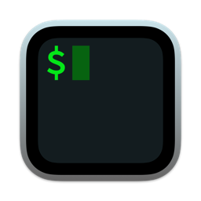
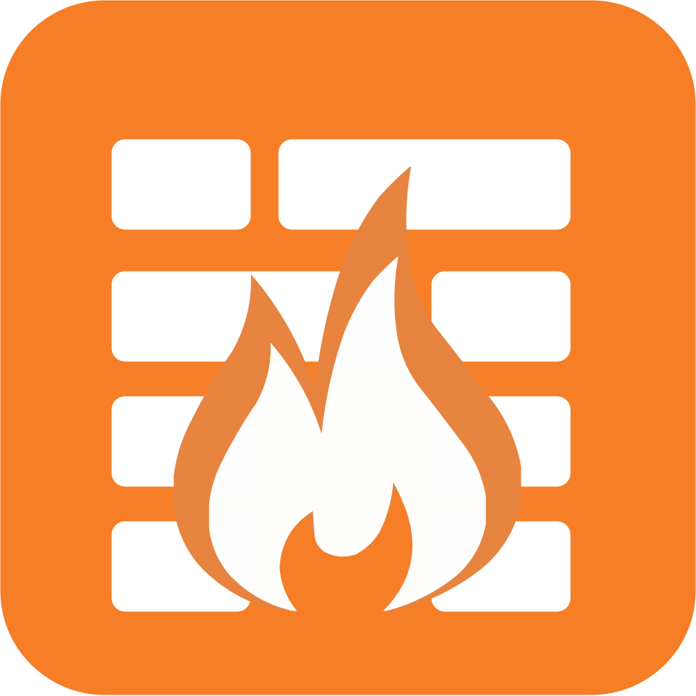

## ZoneTwelve

I work on things that need to **run**, not just compile.

Most of my work focuses on **AI models, training and inference pipelines**, and the tooling required to evaluate, debug, and operate them in real environments.  
When existing tools don’t fit, I build small, focused solutions to close the gap.

I don’t strictly separate research, engineering, and infrastructure — if something blocks the work, I dig into it and fix it.

---

### What I usually work on
- AI model training, inference, and evaluation
- Performance and reliability issues in AI systems
- Tooling and infrastructure to support experiments and deployments
- Debugging unclear, slow, or partially working systems

---

### Tools & environments I often use

|  |  |  |  |  |  |
| :--: | :--: | :--: | :--: | :--: | :--: |
| Python | Node.js | Git | Linux | Shell | Terminal |

|  |  |  |  |
| :--: | :--: | :--: | :--: |
| Kubernetes | Cloud | Database | iptables |

These tools are not goals by themselves — they’re things I use when the work requires them.

---

### Background
I’ve done software security research in the past.  
Today, that experience shows up as a habit of testing assumptions, understanding failure modes, and not trusting systems blindly.

---

### Writing
I occasionally write about things I’m working on or learning:  
https://blog.zonetwelve.io  
(Updates are irregular and usually tied to real work.)

---

### Additional Information

If you’re looking for projects that are objectively a mess but were made with 100% heart and ideas, check out the rest of my work here: [ZoneTwelveWorkspace](https://github.com/ZoneTwelveWorkspace).

<small>Last updated: Apr 2026</small>
